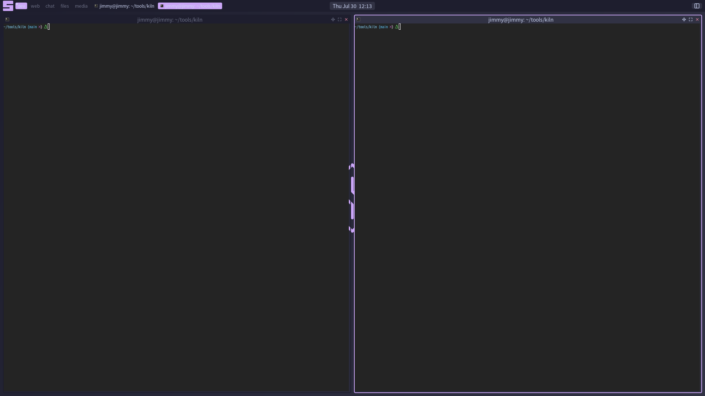
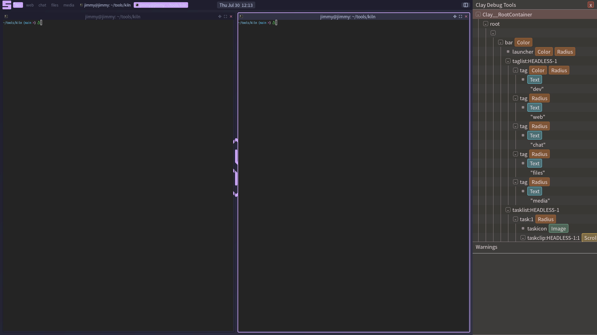
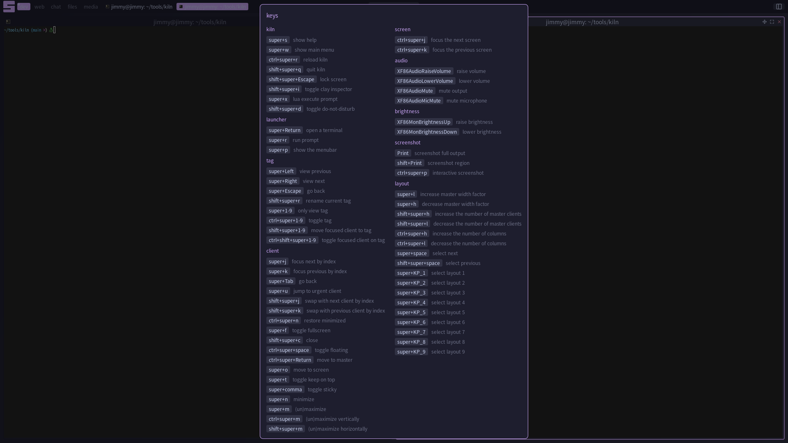
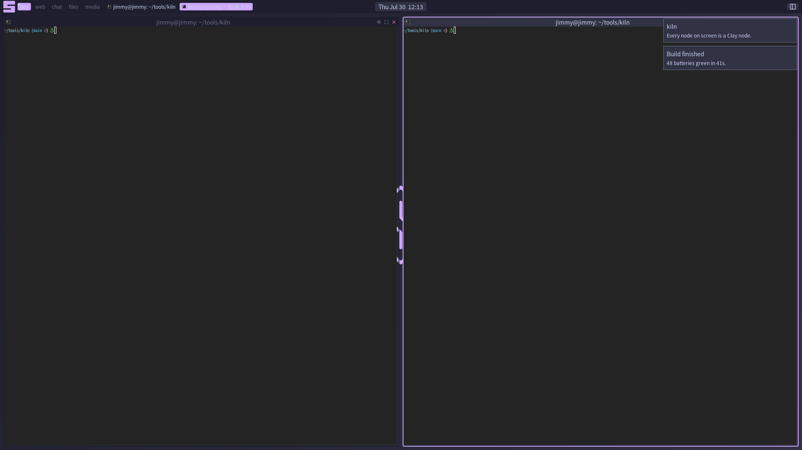

# kiln

A lua-configurable Wayland compositor whose entire surface is one [Clay](https://github.com/nicbarker/clay)
layout tree per screen. Windows, bars, widgets, tags, menus, and notifications
are all Clay nodes.



## One layout tree per screen

Lua declares a node tree per screen on each dirty frame, Clay solves it, and a
thin retained C renderer reconciles the result into a scene graph. There is
exactly one fork, at the leaf: either Clay owns the content (rectangle,
border, text, image), or the node is someone else's Wayland surface, placed at
the box Clay solved for it. Almost everything above that (widgets, clients,
tags, layouts, keys, rules) is Lua over a small, general core with no layout
or hit-testing code of its own.

Because the desktop really is a Clay tree, Clay's debug inspector works on it
directly. Not a reimplementation and not a screenshot tool: the actual
inspector, walking the actual tree that laid out the screen you are looking
at. Toggle it with `mod+shift+i`.



## The Lua API

A config declares what the screen should look like. Nothing imperative, no
draw callbacks, no widget objects to construct and wire together.

```lua
ui.bar(s, { edge = "top", dir = "row", h = th.bar_height,
    color = th.bg, pad = { x = 8 } }, function()
    ui.row({ w = "33.33%", h = "grow", gap = 6,
            clip = { horizontal = true },
            align = { y = "center" } }, function()
        taglist(s)
        tasklist(s)
    end)
    ui.row({ w = "33.33%", h = "grow", align = "center" }, function()
        -- A tooltip is the on_hover handler ui.tooltip makes, nothing else.
        ui.box({ id = "clock", color = th.bg2, radius = 4,
            pad = { x = 8 },
            on_hover = ui.tooltip(function()
                return os.date("%A %d %B %Y")
            end),
        }, widgets.clock)
    end)
    ui.row({ w = "33.33%", h = "grow", gap = 6,
            clip = { horizontal = true },
            align = { x = "right", y = "center" } }, function()
        widgets.systray()
        layoutbox(s)
    end)
end)
```

A bar is a box with children. So is a menu, a notification, and a tiled window's frame. 

The keybinding sheet below is generated from the live bindings, and the
notifications come from kiln's own in-compositor notification daemon.

| `mod+s` hotkeys sheet | notifications |
|---|---|
|  |  |

Full documentation, including a reference for every module, lives at
**[somewm.org/kiln](https://somewm.org/kiln)**.

## Status

Proof of concept. The API is functional and documented but not frozen.
I might update it to follow a more SomeWM compatible API at some point, but not yet.

## Quickstart

Requires meson/ninja and: wlroots 0.20 (for now...), wayland-server, wayland-client,
wayland-protocols, wayland-scanner, xkbcommon, libinput, pixman-1, luajit,
cairo, pangocairo, gdk-pixbuf-2.0. wlroots is used from the system if
present, otherwise built from the vendored subproject, so any machine builds
reproducibly.

    make                 # configure build/ if needed, then build
    make run             # build, then run kiln under a session bus
    sudo make install    # install to /usr/local (override: make prefix=...)

Launched from inside an existing Wayland or X session kiln opens as a nested
window; from a bare TTY it runs on DRM. Installing also adds a session entry,
so display managers list kiln at the login screen. Copy the default config to
`~/.config/kiln/rc.lua` to change layout, keys, rules, theme, and chrome.
`mod+Return` opens a terminal, `mod+s` shows every binding on one sheet, and
`mod+shift+q` quits.

## License

MIT. See [LICENSE](LICENSE).

The layout engine is [Clay](https://github.com/nicbarker/clay) by Nic Barker,
zlib licensed, vendored at `third_party/clay.h`, which keeps its own notice.

kiln shares a maintainer with [SomeWM](https://github.com/trip-zip/somewm),
which is GPLv3, and the default wallpaper shares the one from SomeWM. MIT here
means work can still move from kiln into SomeWM.

Releases up to and including `v0.1.0` were published under GPLv3; that grant
stands for anyone who took the code under it. Everything after is MIT.
